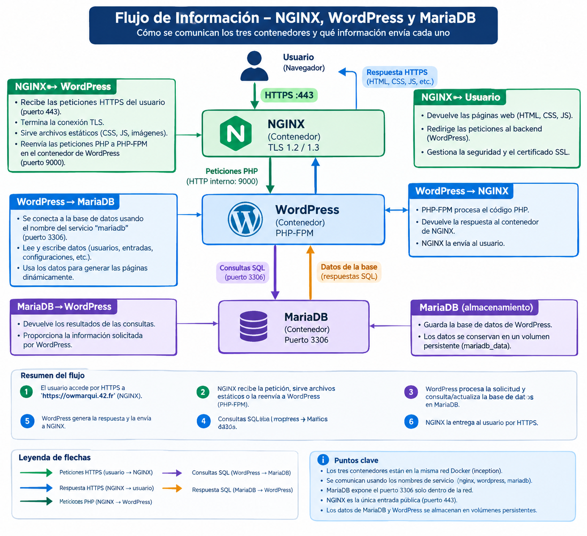
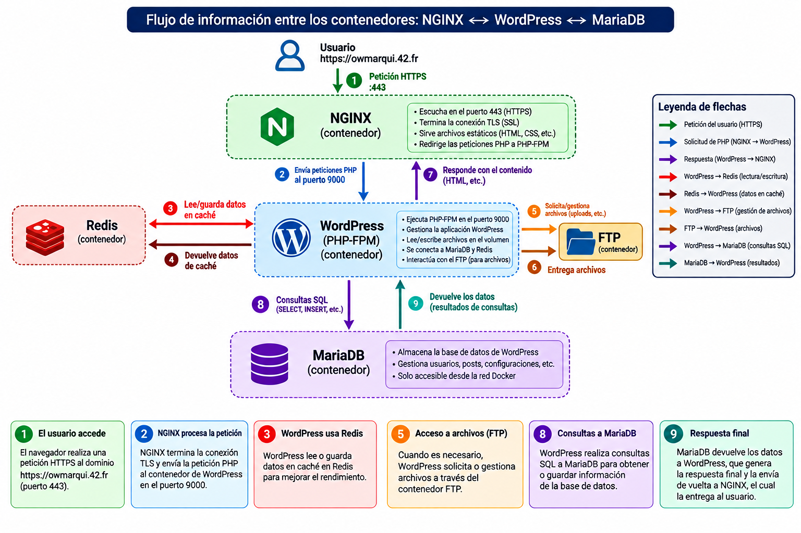
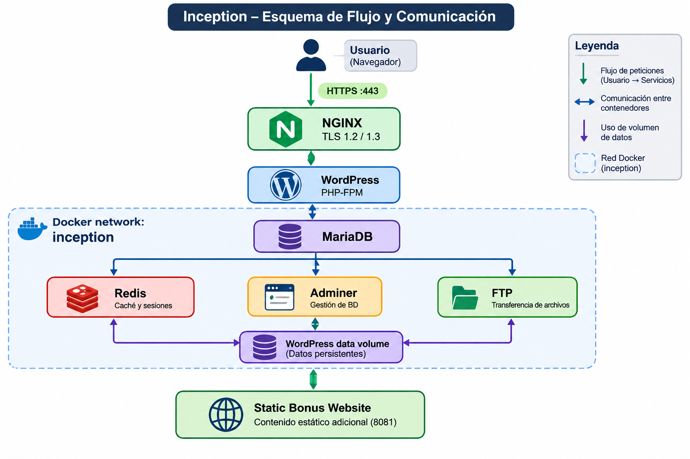

*This project has been created as part of the 42 curriculum by owmarqui-.*

# Inception

## Description

**Inception** is a system administration and Docker project from the 42 curriculum.

The goal of the project is to build a small infrastructure composed of several independent services, each running inside its own Docker container.

The infrastructure is managed with **Docker Compose** and uses custom **Dockerfiles** based on Debian Bookworm. The services communicate through a dedicated Docker network and persistent application data is stored using Docker named volumes.

The mandatory infrastructure consists of:

- **NGINX**: the public HTTPS entry point.
- **WordPress + PHP-FPM**: provides the WordPress website and executes PHP scripts.
- **MariaDB**: provides the database used by WordPress.

The project also implements the following bonus services:

- **Redis**: object caching for WordPress.
- **FTP**: access to the WordPress website files.
- **Adminer**: web interface for MariaDB administration.
- **Static Website**: an additional static website served by NGINX.

### Architecture







### Main Design Choices

Each service runs in its own container and has a focused responsibility.

The images are built from **Debian Bookworm** and the required software is installed directly inside custom Dockerfiles. The project does not rely on ready-made application images.

**Docker Compose** is responsible for building, creating and connecting the services. The **Makefile** provides convenient commands for managing the complete infrastructure.

The services communicate through a dedicated Docker bridge network instead of using the host network.

Persistent WordPress files and MariaDB data are stored through Docker named volumes. These volumes use the local driver with host paths under:

```text
/home/owmarqui/data/
```

This allows the application data to survive container recreation.

---

# Services

## NGINX

NGINX is the public HTTPS entry point of the mandatory infrastructure.

It:

- listens on port `443`;
- uses HTTPS;
- supports TLSv1.2 and TLSv1.3;
- serves the WordPress website;
- forwards PHP requests to PHP-FPM;
- uses a self-signed SSL certificate generated during the NGINX image build.

The project domain is:

```text
https://owmarqui.42.fr
```

Only port `443` is published for the mandatory NGINX service.

## WordPress

The WordPress container contains:

- WordPress;
- PHP-FPM;
- MariaDB client utilities;
- WP-CLI.

PHP-FPM listens on port `9000` internally and communicates with NGINX through the Docker network.

WordPress is automatically configured when the container starts. The database connection and WordPress credentials are provided through environment variables.

The WordPress container does not contain NGINX.

## MariaDB

MariaDB provides the database used by WordPress.

MariaDB listens on port `3306` inside the Docker network. This port is not published directly on the host.

Database files are stored in the persistent `mariadb_data` named volume.

## Redis

Redis is used as an object cache for WordPress.

The WordPress Redis Object Cache plugin is installed and configured to communicate with the Redis service through the Docker network.

Redis listens internally on port `6379` and is not published on the host.

## FTP

The FTP service provides access to the WordPress website files.

It shares the WordPress named volume and therefore operates on the same files used by the WordPress installation.

FTP uses:

```text
Port: 21
Passive ports: 21000-21010
```

## Adminer

Adminer provides a web interface for managing and inspecting the MariaDB database.

The container listens on port `8080`, which is published on the host as:

```text
http://localhost:8082
```

When connecting to MariaDB through Adminer, the database server is:

```text
mariadb
```

## Static Website

The bonus static website is a simple website served independently by NGINX.

It does not use PHP or WordPress.

It is available on:

```text
http://localhost:8081
```

---

# Instructions

## Prerequisites

The project is designed to run inside a Linux environment or virtual machine with Docker and Docker Compose installed.

Required tools:

- Docker
- Docker Compose
- Make
- Git

The project uses the local domain:

```text
owmarqui.42.fr
```

The domain must resolve to the IP address of the machine running the project.

For the current VM configuration, the domain resolves to:

```text
192.168.56.101
```

For example, the corresponding `/etc/hosts` entry can be:

```text
192.168.56.101    owmarqui.42.fr
```

## Environment Configuration

The project requires environment variables for the database, WordPress, FTP and domain configuration.

The real environment file is:

```text
srcs/.env
```

This file contains sensitive credentials and must remain local. It must **never be committed to Git**.

Create the file before starting the project:

```bash
nano srcs/.env
```

The required variables are:

```env
DOMAIN_NAME=owmarqui.42.fr

MYSQL_DATABASE=database_name
MYSQL_USER=database_user
MYSQL_PASSWORD=change_me
MYSQL_ROOT_PASSWORD=change_me

WP_ADMIN_USER=wordpress_admin
WP_ADMIN_PASSWORD=change_me
WP_ADMIN_EMAIL=admin@example.com

WP_USER=wordpress_user
WP_USER_PASSWORD=change_me
WP_USER_EMAIL=user@example.com

FTP_USER=ftp_user
FTP_PASSWORD=change_me
```

Replace the example values with the desired local configuration.

Passwords must remain local and must never be stored directly inside Dockerfiles or committed source files.

## Build and Start

From the project root, the recommended way to manage the infrastructure is:

```bash
make
```

The Makefile uses the Compose configuration located at:

```text
srcs/docker-compose.yml
```

To use Docker Compose directly:

```bash
docker compose -p inception --env-file srcs/.env -f srcs/docker-compose.yml up --build -d
```

## Stop the Infrastructure

To stop and remove the containers while keeping persistent volumes:

```bash
make down
```

Equivalent Docker Compose command:

```bash
docker compose -p inception --env-file srcs/.env -f srcs/docker-compose.yml down
```

Stopping the project does not remove the persistent application data.

## Check the Services

To check the state of the containers:

```bash
docker compose -p inception --env-file srcs/.env -f srcs/docker-compose.yml ps
```

To inspect the logs:

```bash
docker compose -p inception --env-file srcs/.env -f srcs/docker-compose.yml logs
```

To inspect a specific service:

```bash
docker compose -p inception --env-file srcs/.env -f srcs/docker-compose.yml logs nginx
docker compose -p inception --env-file srcs/.env -f srcs/docker-compose.yml logs wordpress
docker compose -p inception --env-file srcs/.env -f srcs/docker-compose.yml logs mariadb
```

To follow logs in real time:

```bash
docker compose -p inception --env-file srcs/.env -f srcs/docker-compose.yml logs -f
```

## Rebuild the Images

To rebuild the images without using the Docker build cache:

```bash
docker compose -p inception --env-file srcs/.env -f srcs/docker-compose.yml build --no-cache
```

Then start the infrastructure:

```bash
docker compose -p inception --env-file srcs/.env -f srcs/docker-compose.yml up -d
```

### Data Warning

Commands that remove volumes are destructive because the volumes contain persistent WordPress and MariaDB data.

The Makefile provides:

```bash
make clean
make fclean
make re
```

These commands should be used carefully because they can remove containers, images, volumes and persistent application data depending on the target.

---

# Access

## WordPress Website

The main WordPress website is available at:

```text
https://owmarqui.42.fr
```

The project uses a self-signed certificate, so the browser may display a security warning. This is expected in this development environment.

## WordPress Administration

The WordPress administration panel is available at:

```text
https://owmarqui.42.fr/wp-admin
```

The administrator credentials are the ones defined in the local `srcs/.env` file.

## Adminer

Adminer is available at:

```text
http://localhost:8082
```

Use the following server name to connect to MariaDB:

```text
mariadb
```

The remaining credentials are defined in the local `srcs/.env` file.

## Bonus Website

The static bonus website is available at:

```text
http://localhost:8081
```

## FTP

FTP is available through:

```text
Port: 21
Passive ports: 21000-21010
```

FTP credentials are stored locally in `srcs/.env`.

---

# Persistent Data

The project uses two Docker named volumes:

- `mariadb_data` — stores MariaDB database files.
- `wordpress_data` — stores WordPress website files.

The volumes are persistent and survive normal container recreation.

The Compose configuration uses Docker's local volume driver with bind options so that the physical data is stored under:

```text
/home/owmarqui/data/mariadb
/home/owmarqui/data/wordpress
```

This satisfies the project requirement for persistent data under `/home/login/data` while keeping the storage associated with Docker named volumes.

---

# Docker Concepts and Design Comparisons

## Virtual Machines vs Docker

A **virtual machine** emulates a complete computer system and normally contains its own operating system and kernel.

**Docker containers**, on the other hand, share the host kernel while isolating applications and their dependencies.

For this project, Docker is appropriate because each service can run in an isolated and lightweight container.

| Virtual Machine | Docker |
|---|---|
| Includes a complete guest OS | Shares the host kernel |
| Higher resource usage | Lightweight |
| Usually slower to start | Fast startup |
| System-level isolation | Application/service isolation |
| Each VM has its own kernel | Containers share the host kernel |

The Inception project itself is required to run inside a **virtual machine**, while Docker is used inside that VM to provide the application infrastructure.

## Secrets vs Environment Variables

**Environment variables** are useful for configuration values such as:

- domain names;
- database names;
- usernames;
- application configuration.

However, environment variables are not a dedicated secret-management mechanism and sensitive values can potentially be exposed through container configuration or process environments.

**Docker secrets** provide a more appropriate mechanism for managing sensitive credentials in environments where secret management is required.

For this project, the subject requires the use of environment variables and a `.env` configuration file. Therefore, credentials are stored in the local `srcs/.env` file and are excluded from Git.

The important distinction is that the `.env` file is used for **local configuration**, while the repository must not contain the actual credentials.

## Docker Network vs Host Network

A **Docker network** provides isolated communication between containers.

Services can communicate using their Docker service names, for example:

```text
wordpress
mariadb
redis
```

For example, WordPress connects to MariaDB using:

```text
mariadb
```

instead of relying on a container IP address.

Using:

```yaml
network_mode: host
```

would make containers use the host network directly and would remove much of the network isolation provided by Docker.

The project therefore uses a dedicated Docker bridge network named `inception`.

## Docker Volumes vs Bind Mounts

A **bind mount** directly maps a specific host path into a container.

For example:

```text
./data:/var/lib/mysql
```

A **Docker named volume** is managed by Docker and is referenced by a volume name rather than directly by a path in the service definition.

This project uses the named volumes:

```text
mariadb_data
wordpress_data
```

The Compose configuration uses Docker's local volume driver with `driver_opts` to associate these named volumes with the required physical storage locations:

```text
/home/owmarqui/data/mariadb
/home/owmarqui/data/wordpress
```

This provides persistent storage while keeping the application configuration based on Docker named volumes.

---

# Project Structure

The repository is organized as follows:

```text
Inception/
├── Makefile
├── README.md
├── USER_DOC.md
├── DEV_DOC.md
├── .gitignore
├── sourcesRM/
│   ├── 3_counterns.png
│   ├── bonus_incepcion.png
│   └── Incepcion1.png
└── srcs/
    ├── docker-compose.yml
    └── requirements/
        ├── mariadb/
        │   ├── Dockerfile
        │   └── conf/
        │       └── init.sh
        │
        ├── nginx/
        │   ├── Dockerfile
        │   └── conf/
        │       └── nginx.conf
        │
        ├── wordpress/
        │   ├── Dockerfile
        │   └── conf/
        │       └── wp_setup.sh
        │
        └── bonus/
            ├── redis/
            │   └── Dockerfile
            │
            ├── ftp/
            │   ├── Dockerfile
            │   ├── conf/
            │   │   └── vsftpd.conf
            │   └── tools/
            │       └── ftp_setup.sh
            │
            ├── adminer/
            │   └── Dockerfile
            │
            └── website/
                ├── Dockerfile
                ├── conf/
                │   └── nginx.conf
                └── site/
                    └── index.html
```

The real `srcs/.env` file is intentionally not part of the repository.

Each service has its own Dockerfile and is built independently.

---

# Security

The project follows the security principles required by the subject:

- No passwords are hard-coded in Dockerfiles.
- Credentials are kept in the local `srcs/.env` file.
- The `.env` file is excluded from Git.
- NGINX is the public entry point for the mandatory WordPress infrastructure.
- HTTPS is provided using TLSv1.2 and TLSv1.3.
- Services communicate through an isolated Docker network.
- The project does not use host networking.
- MariaDB port `3306` is not published to the host.
- PHP-FPM port `9000` is not published to the host.
- Persistent application data is separated from the container lifecycle.
- SSL certificate files are generated inside the NGINX image and are not stored in the repository.

---

# Bonus

The project implements the following bonus services:

### Redis

Provides object caching for the WordPress installation through the WordPress Redis Object Cache plugin.

### FTP

Provides file transfer access to the WordPress data volume.

### Static Website

Provides an additional static website served independently by NGINX without PHP.

### Adminer

Provides a graphical web interface for MariaDB administration.

The bonus services are implemented as independent Docker containers with their own Dockerfiles.

---

# Resources

The project was developed using the following resources:

- 42 Inception project subject.
- Docker documentation.
- Docker Compose documentation.
- Debian documentation.
- NGINX documentation.
- MariaDB documentation.
- WordPress documentation.
- PHP-FPM documentation.
- Redis documentation.
- vsftpd documentation.
- Adminer documentation.

## AI Usage

AI tools were used as a learning and development aid during the project.

They were used mainly for:

- understanding Docker and Docker Compose concepts;
- researching configuration options;
- debugging Docker build and networking problems;
- understanding NGINX, PHP-FPM and MariaDB configuration;
- reviewing shell scripts and Dockerfiles;
- explaining errors encountered during development;
- organizing project documentation;
- reviewing project requirements and identifying missing mandatory elements.

AI-generated suggestions were reviewed, tested and adapted to the project's actual implementation.

The final configuration was tested against the project's requirements and validated through practical execution.

---

# Authors

- **owmarqui-**

This project was developed as part of the **42 curriculum**.